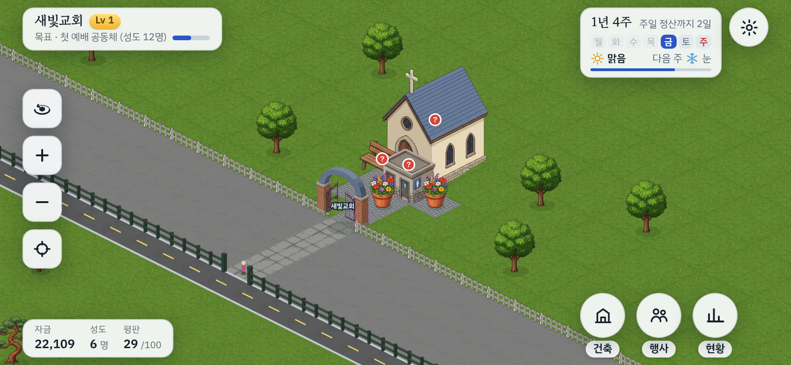

# 초반 30분 플레이 테스트 보고서

`tools/playtest.js`로 세 판을 돌렸다. 봇은 화면에 뜨는 안내(첫 걸음 줄, 챙길 일, 성도들의 바람)만 읽고,
실제 버튼과 지도를 눌러서 진행한다. 보통 난이도, 37주(1배속 30분).

- **그대로**: 건물을 고르면 놓이는 미리보기 자리에서 바로 ✓를 누르는 사람 (seed 5)
- **조심**: 미리보기가 길(바닥) 위면 옆 잔디로 옮기고 짓는 사람 (seed 5, 11)

## 결과 요약

| | 그대로 (seed 5) | 조심 (seed 5) | 조심 (seed 11) | 참고: 돈을 다 쓰는 봇 |
|---|---|---|---|---|
| 첫 걸음 6개 완료 | 3주째 | 3주째 | 3주째 | – |
| 첫 목표(성도 12명) | 못 이룸 | 8주째 | 8주째 | 6주째 |
| Lv 2 도착 | 못 이룸 | 25주째 | 12주째 | 5주째 |
| 30분 시점 Level | 1 | 2~3 | 4 | 8~11 |
| 30분 시점 성도 | 6명 | 25명 | 49명 | 110~140명 |
| 30분 시점 남은 자금 | 약 39,000 | 약 44,000 | 약 58,000 | 약 4,000 |
| 한 일이 없던 주 | 22주 | 12주 | 6주 | – |
| 이용 불가로 남은 건물 | 예배실·화장실 등 전부 | 벤치·기도실 | 소그룹실·예배실 | – |

첫 걸음은 세 판 모두 3주 안에 끝났다. 문제는 그다음이다.

## 찾은 문제

### 1. 첫 건물이 예배실 길을 막는다 (가장 큼)

- 건물을 고르면 미리보기가 화면 가운데에 놓인다. 시작 화면의 가운데는 교회 앞길이고, 그 자리의 ✓는 초록색이다.
- 그대로 ✓를 누르면 화장실이 길 위에 지어져 예배실로 가는 길이 끊긴다. 벤치와 화분도 같은 자리에 놓인다.
- 챙길 일에는 "예배 공간에 닿는 길이 없어요. 길을 이어 주세요"가 뜬다. 하지만 건물 카드에는 "입구까지 길이 없어 이용 못 해요"만 나오고 길 잇기 버튼이 없다.
- 이 판은 37주 내내 성도 5~6명에서 멈췄다. 첫 건물 하나로 게임이 사실상 끝난다.
- 미리보기가 길 위에 놓인 횟수: 그대로 7번, 조심 22번·33번. 조심하는 사람도 매번 옮겨야 한다.

### 2. 이용 불가인 건물을 고칠 방법이 카드에 안 보인다

- 조심해서 지어도 두 판에서 건물 4곳(벤치, 기도실, 소그룹실, 작은 예배실)이 끝까지 이용 불가로 남았다.
- 원인은 건물의 문이 나무나 다른 건물 쪽을 보고 있어서다. 게임은 이유("이을 수 있는 자리가 없어요. 문 위치를 바꿔 보세요")를 알고 있지만 카드에는 보여 주지 않는다. 길 잇기 버튼도 사라진다.
- 챙길 일의 "이용할 수 없는 건물 N곳 (문·길 확인)"은 어느 건물인지, 무엇을 하면 되는지 알려 주지 않는다.

### 3. 돈이 쌓이는데 쓸 곳을 알려 주지 않는다

- 안내만 따른 조심 플레이는 30분에 44,000~58,000원이 남았다. 시작 자금의 두세 배다.
- 챙길 일과 성도들의 바람은 벤치·화장실·기도실 같은 작은 일만 시킨다. 한 주에 600~2,000원이 들어오는데 시키는 일은 그보다 싸다.
- 그래서 Level이 늦다. 돈을 다 쓰는 봇은 5주째에 Lv 2인데, 안내만 따르면 12~25주째다. 지난번에 맞춘 "Lv 2는 3~5분"은 돈을 다 쓰는 사람 기준이었다.
- 목표 줄은 "성도 12명"처럼 결과만 말하고, 어떻게 늘리는지는 말하지 않는다.

### 4. 주일 영수증이 건축 패널을 덮고, 누르면 재정 화면으로 넘어간다

- 영수증은 매주 5초 동안 오른쪽 위에 뜬다. 건축 패널이 열려 있으면 분류 버튼(편의·주차 등) 위를 가린다.
- 그때 분류 버튼을 누르려다 영수증을 누르면 건축 목록이 현황 › 재정으로 바뀐다. 건축 버튼을 다시 눌러야 한다.
- 다음에 현황을 열면 재정 탭이 먼저 떠서, 수리 버튼이 있는 현황 탭으로 한 번 더 넘겨야 한다.

### 5. 작은 문제

- **"주차가 모자라 방문자가 줄어요"가 1주째부터 뜬다.** 성도 6명인 첫 주의 맨 위 안내다. 주차장은 첫 목표 뒤에 열려서, 그 전에는 자전거 거치대만 지을 수 있고 경고도 안 풀린다.
- **성도들의 바람 문구가 어색하다.** "예배 자리이(가) 더 필요해요", "돌봄 공간이(가) 더 필요해요".
- **바람이 소모임 건물을 가리킬 때** 소모임 안의 운동·취미·음악 묶음을 눌러야 그 카드가 보인다. 어느 묶음인지는 문구에 없다.
- **✓ 버튼이 가려진다.** 미리보기가 화면 가장자리에 가면 ✓가 다른 UI 밑에 깔려 눌리지 않았다(조심 판에서 2번).

## 잘 된 점

- 첫 걸음 6개는 막힘 없이 3주(약 2분 반) 안에 끝났다.
- 문 열기, 행사 열기, 직분자 임명은 한 번에 됐다.
- 길 잇기 버튼이 뜬 경우에는 두 번 누르는 것으로 길이 이어졌다.
- 37주 동안 자바스크립트 오류는 없었다.

## 테스트의 한계

- 봇은 화면 문구를 정해진 규칙으로 해석한다. 사람은 더 영리하게 풀 수도, 더 헤맬 수도 있다.
- 봇은 지도를 끌거나 돌리지 않는다. 화면에 보이는 곳에만 짓는다.
- 시간은 빨리 넘겼다. 영수증이 5초 뒤에 사라지는 것을 기다리지 않고 바로 다음 행동을 한다. 그래서 "영수증이 덮은 횟수"는 실제보다 많이 잡혔다.
- 작은 건물을 누를 때 옆 나무가 대신 골라지는 일이 많았다. 봇이 누르는 위치 탓일 수 있어 문제로 세지 않았다.

## 다시 돌리는 법

    node tools/playtest.js --weeks 37 --seed 5
    node tools/playtest.js --weeks 37 --seed 5 --careful
